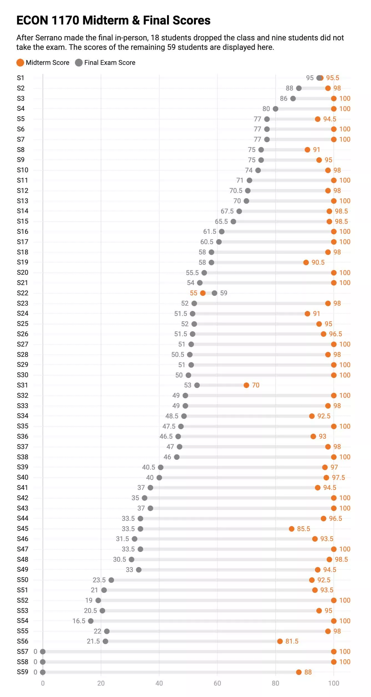

In education, there's a concept, first introduced by David Pearson and Margaret Gallagher, called the gradual release of responsibility [@pearson1983]. This is a pedagogical method wherein the instructor initially holds all the responsibility for learning, and students are gradually given more and more responsibility until they are learning independently. In a math setting, let's say, learning how to complete the square to solve quadratic equations, this might look like 

* The instructor works through an entire problem showing each step of the completing the square algorithm.
* The instructor works through another completing the square problem, but this time, they stop before a couple of steps and ask the students what the next step should be.
* The instructor works through another problem, and asks the students what comes next for each step.
* The instructor gives one more problem, and has the students solve the problem while they observe.
* The instructor gives homework to be completed independently. 

And so, the responsibility for learning initially rested entirely on the instructor's shoulders, but more and more responsibility was handed off to the student until they were expected to complete the homework by themselves. This is sometimes referred to as "I do, we do, you do" instruction, first coined by Doug Fisher and Nancy Frey [@fisher2008]. While this framework is most commonly applied to instructor/student interactions on a lesson-by-lesson basis, we can zoom out and apply it more broadly to a student's educational career. A student beginning elementary school is, broadly speaking, engaged in "I do" work. The responsibility for their learning rests entirely with the instructor, and the student has little to no control over their educational experience. For the most part, the student remains in the "I do" stage throughout high school. The student is taking classes required by their school with very little independent choice. They learn to do trigonometry or write an essay by following strict formulas. They read books that are assigned by their teachers. None of this, in a vacuum, is bad. The "I do" stage is very important, both within a single lesson and within education itself. A student has to learn how to learn before they can go out and do it effectively on their own, and we see this progression in undergraduate education. A student slowly picks their major, works through upper level courses, and finally completes a bachelor's thesis; they work through the "we do" stage, gradually taking more and more responsibility for their own learning. And then when a student progresses to grad school, they're often in a situation where they're solely responsible for learning the material. 

The key factors that govern this large-scale gradual release of responsibility (GRR) are student motivation and expertise. Without the motivation to actually learn, you can't trust a student not to seek shortcuts, and without the expertise, you can't rely on the student to judge whether they're truly learning effectively. As the student's expertise grows, they become more able to learn for themselves, and they're afforded more freedom to focus on subjects they have passion for, increasing their motivation. Alongside this growth, they're entrusted with more responsibility for their own learning. 

This is the framework into which we're trying to implement AI, and so we must take into account where the responsibility for learning lies when deciding what AI usage is appropriate. With the advent of LLMs, there are three entities that can hold some amount of responsibility for student learning: the instructor, the AI, and the student. Getting the balance right is critical, as many educators have learned. 

{width=50%}

There has obviously been work on this question previously. Perkins, Furze, Roe, and MacVaugh released a paper detailing a descriptive framework of AI usage in educational assessments in 2024 [@perkins2024]. Their framework is no AI, AI-assisted idea generation and structuring, AI-assisted editing, AI task completion and human evaluation, and full ai. While this is a solid descriptive framework, it primarily focuses on different levels of independent student usage of AI to complete assignments. It doesn't supply a guiding principle for the instructor to decide which level is appropriate for their students, and this is the gap I believe a GRR framework can fill. 

In lower level courses, which students are often forced to take with little to no input, AI interaction should be extremely restrained. Up through undergraduate introductory or general education courses, AI should mostly be used by the instructor to implement tools they might not be able to do otherwise. Once a student has been able to start a degree path and invest time developing their expertise in their chosen subject, then they should be able to shoulder the burden of more unrestricted AI usage, although it should be with well-defined objectives and limitations. Unrestricted AI usage, insofar as it has anything to do with accredited education, should be limited to students working with a great deal of expertise and motivation. A graduate student researcher, for instance, might well utilize AI in an unrestricted manner to learn new tools, statistical methods, and gain a deeper overview of their field, and this is good AI usage! But it only comes into play when a student is able to take responsibility for their own learning, like we expect for graduate students. Earlier than that, I fear the results of Professor Serrano's infamous ECON 1170 course are the rule rather than the exception [@whitford2026]. 

I propose the following framework to help differentiate different levels of AI responsibility. 

Level 1
: &nbsp;&nbsp;&nbsp;&nbsp;No direct AI/student interaction. All responsibility remains with the instructor.

Level 2
: &nbsp;&nbsp;&nbsp;&nbsp;AI is used to interpret student responses. Almost all responsibility remains with the instructor.

Level 3
: &nbsp;&nbsp;&nbsp;&nbsp;AI is able to reply to student responses within the scope of a well-defined exchange. The instructor defines system prompts for the AI and objective briefings for the student, and the responsibility entrusted to the student and to the AI is determined by the scope of the prompt and the briefing.

Level 4
: &nbsp;&nbsp;&nbsp;&nbsp;AI may be used freely to investigate. The instructor may set an assignment scope, but all remaining responsibility for learning rests with the student.

At level 1, the AI is a nonentity in the learning exchange. If AI is used, it is used solely to develop a tool, and the instructor bears all responsibility for the accuracy and content of this tool. This is where, I believe, the bulk of potential for AI usage lies, letting instructors develop tools that weren't feasible for them before. My [pharmacy calculation practice app](/portfolio/pharmacy-practice-app/index.qmd) is one such example. It was always theoretically possible for me to make this tool, but I never would have found the time to develop it on my own. While AI was used heavily to develop the question bank, I still bear the responsibility to the accuracy of these questions, which I tried to ensure by programmatically generating solutions from problem inputs, checking initial questions by hand, editing solution templates, and continuing to use the tool itself daily so that I can catch other potential problems I missed. The student never actually interacts with the AI.

At level 2, AI can be used to interpret student work, but the AI does not reply to the student. We might consider using AI to identify and sort mistakes in student calculations as an example of a level 2 AI usage. We've started to release some responsibility to the AI, but the student experience hasn't changed from level 1. They're still doing the same work, and the difference here is how we're interacting with that work. While I don't think AI should ever take sole responsibility for grading student work, modern LLMs offer an ability to investigate, interpret, and categorize student work that hasn't existed. For example, it would be possible to save and scan a semester's worth of student math work and then analyze the work and sort the errors into conceptual, procedural, and computational errors. This data can then be used to identify pain points in pedagogy or areas of weakness in student prerequisite skills. 

Level 3 is where the student and the AI are finally allowed to interact directly. This is the level that every new edtech company under the sun is trying to develop tools for, and this is the level where we must take the most care as educators. 

![A staged screenshot showing a customer asking a McDonald's chatbot to write a python program [@goel2026].](mcdonalds-ai-chatbot.webp){width=50%}

Here, it's very easy for a student to overstep the bounds of the assignment, either to disengage with the work altogether or to undercut the desired learning experience of the assignment. Unless you have students that are motivated enough by the material to remain within the guidelines you set for the assignment, you might restrict these assignments to in-class only or require logs of student interactions. Level 3 assignments have a very wide range in how much responsibility rests with the AI. At the lowest level, the interaction might consist of a single prompt and response between the student and AI. At the higher ranges, the interaction might look more like a tutoring session. The [statistics analysis trainer](/portfolio/statistics-training/index.qmd) is an example of a higher range level 3 interaction. At this level, it is critical to define exactly what your expectations are for both the student and the AI. For the AI, we might craft a strong system prompt that defines the setting of the interaction, the steps and expected student responses at each step, as well as instructions to redirect the student back to the assignment if they start to go outside the boundaries. For the student, we want a similarly strong orientation brief that lays out the exact expectations of the student at each step of the interaction and what the end-product of the interaction should be. 

Finally, level 4 is where the student bears total responsibility for their own learning, with the instructor only providing the assignment parameters, and might be best thought of as self-study. My personal attempts to learn R, which led to the aforementioned R analysis session framework, might fall under this category. I started that project because I wanted to learn R for my own benefit, and so I could trust myself not to seek shortcuts. I also had the relevant expertise, having a master's degree in mathematics, to be able to guide the AI when it started to get hung up on irrelevant points. If a student is not able to handle both, it's difficult to justify allowing this sort of interaction in an actual course. Insofar as a level 4 assignment might appear in a primary, secondary, or undergraduate curriculum, I can only imagine it working as some sort of low-stakes, participation-only assignment and should otherwise be avoided. 

This might seem unnecessarily restrictive to those that view a greater and more transformative role for AI in the classroom. We want to encourage AI fluency, and students will use AI freely in their own time, so we must implement AI widely in education to keep up. I think this misses the point. While AI is poised to make great changes to the field of education, and I believe it has the potential to do so in positive ways, it does not fundamentally change the nature of human learning. It gives educators a new and powerful tool to craft educational experiences that would have been impossible previously, but it does not transform unprepared learners into capable, independent learners. Additionally, we can implement these sorts of AI fluency activities into the classroom. Indeed, an occasional level 3 activity with supervision and chat logs, does help teach AI fluency. An assignment to generate an AI essay and then grade that essay based on a rubric would be one excellent way to teach both the limitations to AI and allow the students to approach the essay writing process from a new direction. But, ultimately, if we want the student to learn how to write an essay, they must actually write an essay, and that's not something we can thrust upon the students without first slowly giving them the tools, knowledge, and responsibility to do so. 