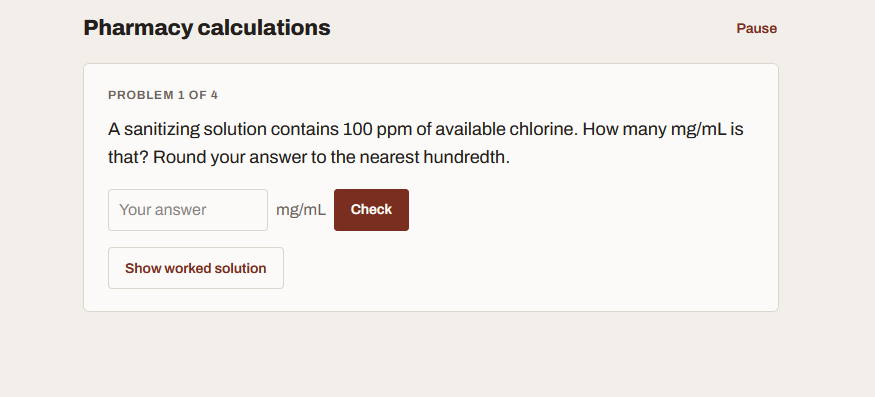
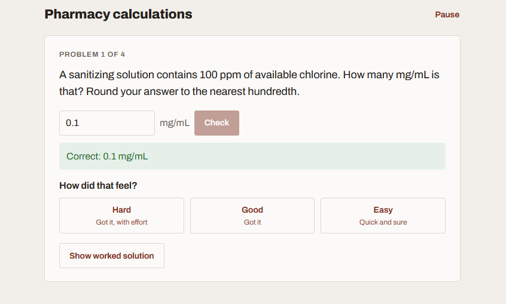
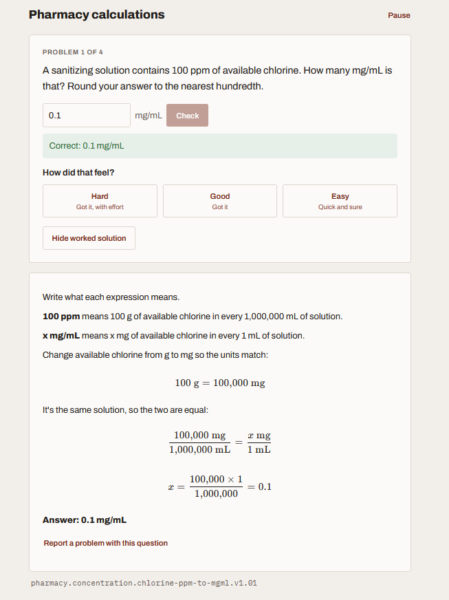
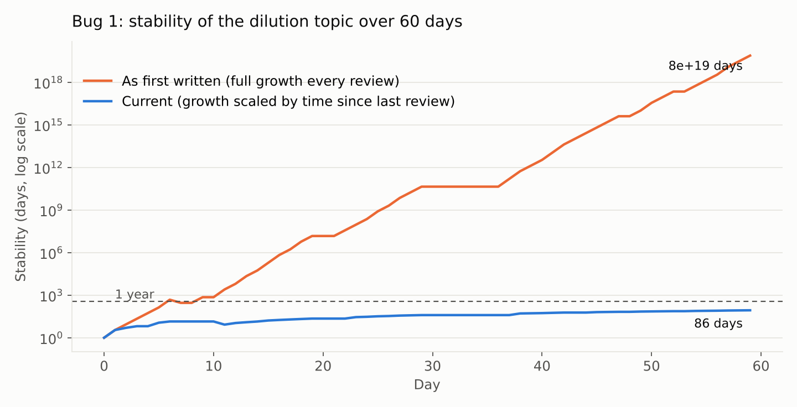
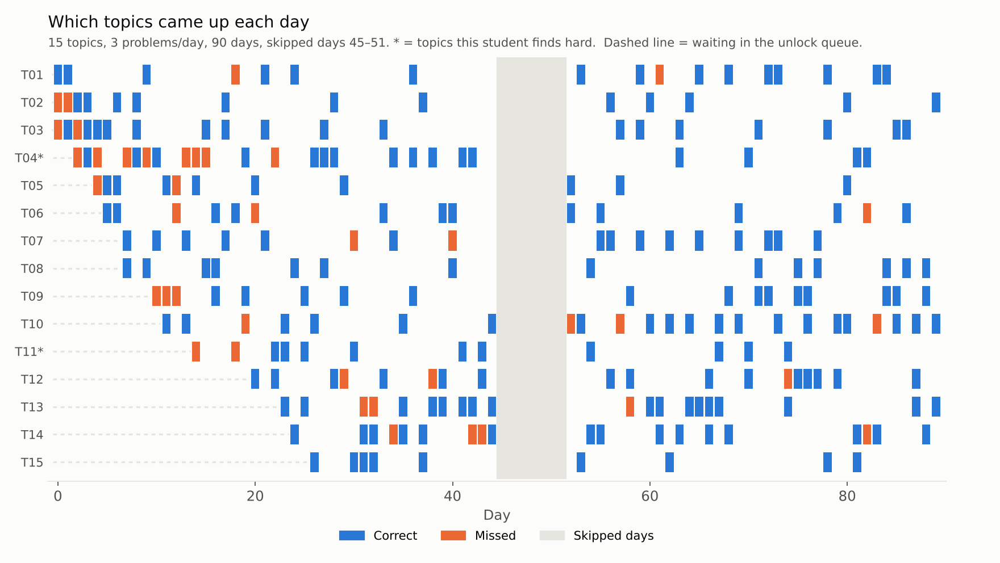
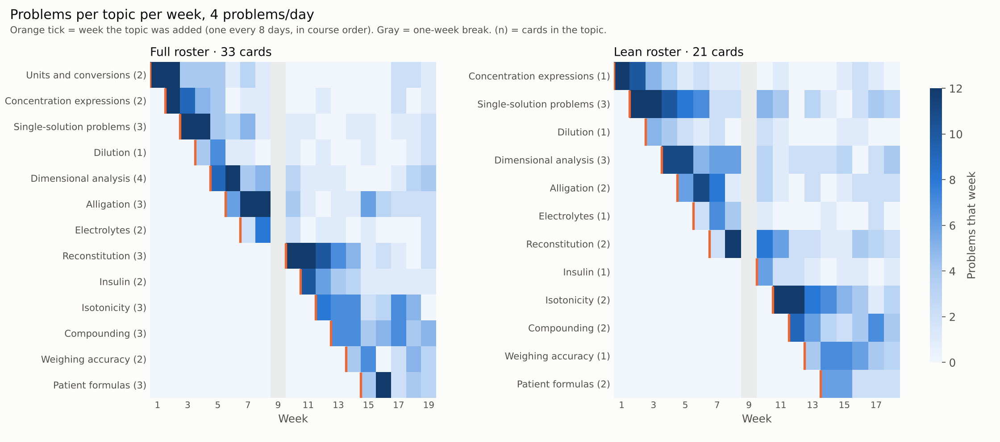

## The problem

Students in pharmacy school face unique challenges with pharmaceutical calculations. One problem in particular is the need for long-term retention of the material for boards. Pharmacy programs tend to be four year programs with the first three years being didactic and the final year being clinical rotations. Pharmaceutical calculations are often introduced in the first year, but then there's a gap of three or more years before that material is required for board exams. To prepare students, pharmacy programs will commonly have cumulative review checkpoints throughout their curriculum to ensure that a student has retained (or recrammed) a basic level of understanding of pharmaceutical calculations. For example, a calculation refresher class during the third year and a board review program in the fourth year.

In spite of these refreshers, students often struggle with retention of the pharmaceutical calculation strategies. In other areas, such as the Top 300 drugs, students can rely on proven, spaced-repetition programs (such as Anki) to aid in retaining this sort of information, but no easy spaced-repetition program exists for pharmaceutical calculations. This program is an attempt to fill that gap.

## Design rationale

The core of this program is a practice problem bank combined with an Anki-inspired scheduler. Using Claude Opus 5.5, practice problem templates were generated for each topic subdivided by solution process (called skills in the program). Practice problems were generated using random input numbers according to realistic ranges for their problem, and then solutions were generated using custom python programs to ensure accuracy.

When a student first opens the program, they're asked to select from a list of topics to build their deck. More topics can be added to their deck later, which allows students studying for review or board prep to select all topics, and students using the program alongside a course can slowly add new topics as they go. The student also selects a desired number of problems per day, with a recommended amount typically being three or four problems. This is an intentional change to the Anki design, where missing a day can lead to the load for the next day being unreasonably large. Here, the load is kept to a fixed amount with an optional catch-up mode that can give the student up to 50% additional problems if they have outstanding skills due.

This program uses a simplified version of the Anki FSRS algorithm to schedule problems based on the expected likelihood of a student getting that particular skill correct. The algorithm uses a statistic called "stability" to schedule each skill. Stability is roughly defined as the number of days after seeing the skill that it takes for a student to fall to a 90% expected probability of successfully solving the skill. Once a skill falls to its 90% solve probability, it becomes due, and the algorithm will start trying to show that skill again. 

The program updates stability based on both whether a student got the latest instance of that skill correct or not, as well as an Anki-inspired difficulty rating for that problem. If a student gets a question wrong, they're asked if they missed the problem due to an obvious mistake (slip) or if they were stuck on the problem altogether. If a student gets a problem correct, they're asked to rate the problem as either hard, good, or easy. This rating gives a multiplier to stability, causing stability to shrink or grow by different amounts. 

In addition, worked solutions for each problem are provided. These solutions were also generated by Claude Opus 5.5 from solution templates developed by the author. Solutions can be viewed both before an answer is given and after with an early peek counted as a stuck question.

Altogether, this app is designed to keep the student's cognitive load to an absolute minimum while still providing them with an interleaved, spaced repetition practice regimen. The student never has to search for practice problems, try to keep track of which skills need attention, or worry about looking up solutions. The student is given a personalized study regimen that fits their schedule and adapts as they grow, while only requiring a ~15 minute time investment every day they choose to study. 

## Showcase

A demo version of the app can be found [here](https://wallaceterrywayne.github.io/practicecalcs/pharmacy/demo). 



## How AI was used

This project fell under a [level 1](/blog/posts/2026-11-ai-instructor-framework/index.qmd) AI-assisted educational project, where the focus is on keeping AI involvement separate from the student experience. AI was used heavily in the question bank development and app coding. To ensure a high-quality question bank that fully covered the different calculations encountered by pharmacy students, a list of topics was written by the author. Then, for each topic, they were divided into skills based on the solution processes needed, referencing [this calculations flowchart](/portfolio/pharmacy-calculation-flowchart/index.qmd). For example, dilution and evaporation problems, while seemingly divided into two separate skills, actually follow nearly identical solution processes: solve a single variable equation for $c_1 v_1 = c_2 v_2$. Single-solution problems, on the other hand, were divided into three skills depending on if the student needed to identify concentration, amount of drug or total, or amount of solvent. Once the list of topics and skills was finalized, Claude Opus 5.5 was utilized to create roughly a dozen different problem templates per skill (changing the relevant drug or scenario). Then, for each template, five or six individual problems were generated to make up the problem bank. 

To avoid AI-hallucinations, the individual problems used randomly generated input numbers generated by the AI to fall within reasonable expected ranges for the template's drugs. The solutions to each problem, on the other hand, were generated programmatically from the input numbers using an AI-created Python program for each problem template. I then checked an examplar from each skill to check for any obvious errors. To further ensure the accuracy of problems, I engage in a daily routine of solving my own practice questions to identify bad questions or otherwise check the quality of the app. 

Claude was also used to generate the worked solutions for each problem template. For each skill, an examplar solution was developed by Claude, based off of example solution processes I developed. These exemplars were then presented to me and checked for accuracy and style, and the style point in particular is where Claude seems to struggle the most. I would often make changes to have the solution processes flow better or focus only on the key points of the problem. Once a solution template was approved, Claude would fill in the template for each associated problem. 

In addition to the question bank, Claude Opus 5.5 was heavily used to develop the code for the website. As before, I engage in regular testing of the app to ensure all features work correctly. 

The app was also able to be further tested using Claude by way of simulation. Claude was able to run simulations to identify bugs and test our algorithm against other algorithms. For example, an initial implementation of the algorithm had stability grow without limit, and would quickly lead to strong skills never being checked up on. 

It was also possible to run simulations of student usage of the app under different assumptions to fine-tune the algorithm or test against other algorithms, such as a full implementation of the FSRS algorithm. 

It was even possible to generate entire cohorts of students with different study and app-usage habits to test their performance under a variety of study methods, with a focus on app usage vs. cramming. The results for one cohort of simulated students is shown below.

| Student | Problems/day | Habit | Course homework only | Cram recent topics | Cram everything | App | App + cram everything |
|---|---:|---|---:|---:|---:|---:|---:|
| Ava | 4 | Daily | 10% / 5% | 74% / 39% | 94% / 67% | 93% / 85% | 99% / 90% |
| Ben | 3 | Weekdays | 10% / 5% | 75% / 37% | 94% / 68% | 86% / 76% | 99% / 88% |
| Cara | 5 | Spotty | 13% / 8% | 77% / 42% | 94% / 71% | 91% / 82% | 99% / 90% |
| Dev | 4 | Crammer | 9% / 4% | 73% / 34% | 94% / 66% | 79% / 59% | 98% / 86% |
| Eli | 6 | Daily | 12% / 7% | 77% / 43% | 94% / 72% | 96% / 90% | 100% / 91% |
| Fay | 3 | Fading | 10% / 5% | 74% / 36% | 94% / 65% | 66% / 48% | 98% / 84% |
: Daily: studies about 95% of days. Weekdays: skips weekends. Spotty: studies about 70% of days, with occasional multi-day gaps. Crammer: studies every day in the week before an exam, otherwise about a third of days. Fading: starts nearly daily and drops off over the term. Scores are final exam / 30 days after the term. {#tbl-time}

The average results for expected time spent studying across several different methods, as well as the simulated exam score and recall 30 days later. 

| Strategy | Extra problems | Extra hours | Final | 30 days later |
|---|---:|---:|---:|---:|
| Course homework only | 0 | 0.0 | 11% | 6% |
| Cram recent topics | 196 | 13.1 | 75% | 39% |
| Cram everything | 456 | 30.4 | 94% | 68% |
| App | 335 | 22.3 | 85% | 73% |
| App + cram everything | 789 | 52.4 | 99% | 88% |
: Time and recall (averaged over the six students; 4 minutes per problem; class and homework time kept constant for each strategy.) {#tbl-cohort}

Note that these simulations used a very simplified mathematical model for skill decay, and these results shouldn't be compared to actual student performance on an exam. The simulated results mostly confirm the common knowledge that more time spent studying results in higher scores, but app usage divides up 22 expected study hours into 15-minute/day sized chunks, and it improves retention 30 days later over cramming-reliant strategies. Both of these aspects are highly desirable for our target student population (extremely busy pharmacy students who need to retain information for boards), and so this simulation is taken as a positive signal. The dismal course homework only scores assume a student who does the assigned homework and then never reviews that information again, so this is also expected as baseline performance.

<!-- ## Privacy and ethics

*Anonymous IDs, no timestamps, consent and IRB flags built in before launch.*

## Evidence of impact

*Usage and outcomes, as available.* -->

## Reflection

This app was met with some excitement from students, many of who are already familiar with the Anki app. The author, while also doing daily practice problems from the app, has noticed a marked improvement in readiness for doing these calculations, even as someone with prior expertise in the topic. Given the potential for this app to aid with board prep, next steps will hopefully involve a small pilot study with fourth-year pharmacy students in a board prep program. 
